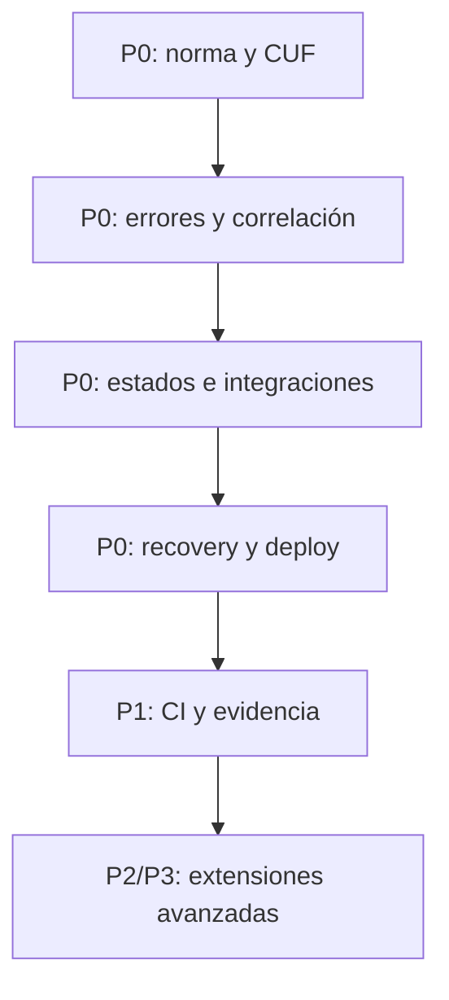

# HACHE BASE — PRODUCTION READINESS ROADMAP

**Estado:** roadmap vivo consolidado al 24 de septiembre de 2026

**Origen:** propuesta inicial del 1 de septiembre de 2026
**Regla:** cambios incrementales, conservadores, auditables, reversibles y probados.

**Fuente normativa:** `PRODUCTION-READINESS-STANDARD.md` v1.1, especialmente su registro canónico de controles (sección 24). La Checklist no crea trabajo adicional; solo representa esos controles.

La intención, beneficios y riesgos originales se conservan en este roadmap. La columna **Estado actual** es la fuente de avance del plan; para evidencia, límites de piloto y la matriz P2-04, consultar `CONSOLIDATION-2026-09.md`.

---

## 1. Criterios de priorización

- **P0:** evita declarar listo un sistema que puede perder/corromper datos, duplicar efectos, exponer seguridad o no recuperarse.
- **P1:** convierte el baseline en verificable/automatizable y cubre calidad operativa esencial.
- **P2:** aumenta madurez, escala o ergonomía sin bloquear por sí solo la mayoría de releases.
- **P3:** optimización avanzada o adopción dependiente de casos reales.

Complejidad: **Baja** (docs/tests/config), **Media** (primitive reusable o cambios coordinados), **Alta** (persistencia/infra/proveedores/migración).

## 2. Secuencia conservada

La secuencia evita construir APM, colas o pipelines pesados antes de contratos claros. P0 y P1 ya recorrieron esa secuencia; P2 y P3 conservan los límites indicados abajo.

## 3. P0 — Baseline que bloquea Production Ready

| ID | Intención original | Beneficio | Riesgo/Complejidad | Dependencias | Estado actual |
| --- | --- | --- | --- | --- | --- |
| P0-01 | Paquete documental normalizado, enlazado desde catálogo/README, con Standard como fuente única. | Definition of Done trazable. | Baja/editorial. | Norma. | **IMPLEMENTED** |
| P0-02 | Plantilla `CRITICAL-USER-FLOWS.md` con nivel, estados, pruebas, señales y recovery. | Visibiliza recorridos críticos. | Baja. | P0-01. | **IMPLEMENTED** |
| P0-03 | Contrato Core de error, códigos estables y `request_id`, compatible con `ApiResponse`. | Respuestas consistentes e investigables. | Media/compatibilidad. | Consumidores de API. | **IMPLEMENTED** |
| P0-04 | Request/correlation ID y logging estructurado con redacción de secretos. | Correlación entre fronteras. | Media/PII y volumen. | P0-03. | **IMPLEMENTED** |
| P0-05 | Estados asíncronos y operation/event ledger primero en fixtures. | Distingue accepted de confirmed. | Media/Alta. | P0-02/P0-04. | **IMPLEMENTED** |
| P0-06 | Inbox/outbox/idempotency claim opt-in con pruebas de concurrencia y reprocess. | Integraciones seguras. | Alta; no todas las apps lo necesitan. | P0-05. | **IMPLEMENTED** |
| P0-07 | Headers configurables: CSP report-only, HSTS opt-in y proxy HTTPS documentado. | Reduce XSS/misconfiguración. | Media; puede romper assets. | Inventario de recursos. | **IMPLEMENTED** |
| P0-08 | Sesión: regeneración, expiración, logout y trusted proxies. | Mitiga fixation/cookies inseguras. | Media. | Flujo auth real/fixtures. | **IMPLEMENTED** |
| P0-09 | Liveness/readiness/smoke separados y verificación de body/version. | Evita falsos `HEALTHCHECK_OK`. | Baja/Media. | Endpoint de proyecto. | **IMPLEMENTED** |
| P0-10 | Fases de deploy, trap de fallo, runbook y ventana de observación. | Fallo parcial visible/recuperable. | Media. | P0-09/staging. | **IMPLEMENTED** |
| P0-11 | RPO/RTO, restore aislado y alerta de freshness. | Demuestra recuperación. | Media/Alta. | Backup/staging/storage. | **IMPLEMENTED** |
| P0-12 | Supply chain: lockfiles, SCA, secretos, triage/SLA y licencias. | Reduce riesgo de release. | Media. | Inventario de stacks. | **IMPLEMENTED** |

### Estado del criterio de salida P0

Los contratos y fixtures de P0 están **IMPLEMENTED en Hache Base**. Esto acredita el baseline reusable; no declara `PASS` de producción para un proyecto derivado.

## 4. P1 — Evidencia y automatización esencial

| ID | Intención original | Beneficio | Riesgo/Complejidad | Estado actual |
| --- | --- | --- | --- | --- |
| P1-01 | Reporte CI de readiness por nivel desde los IDs canónicos. | Resultado auditable sin auto-PASS. | Media. | **IMPLEMENTED** |
| P1-02 | Tests HTTP de headers, cookies, cache, compresión, status, redirects y CSP. | Configuración real verificable. | Media. | **IMPLEMENTED** |
| P1-03 | Lighthouse y accesibilidad sobre fixtures/CUF con budgets. | Regresión temprana de performance/a11y. | Media. | **IMPLEMENTED** |
| P1-04 | RUM/Web Vitals opt-in y minimizado. | Evidencia p75 de campo. | Media. | **IMPLEMENTED** |
| P1-05 | Inventario de terceros con datos, timeout/fallback y coste. | Control de riesgo/bloat. | Baja. | **IMPLEMENTED** |
| P1-06 | Matriz de caché por tipo de respuesta. | Evita datos privados cacheados. | Baja/Media. | **IMPLEMENTED** |
| P1-07 | Formulario fixture B con validación, CSRF, rate limit, honeypot y dedupe. | Patrón demostrable. | Media. | **IMPLEMENTED** |
| P1-08 | Extension de email status/webhooks y reprocess. | Trazabilidad de entrega. | Alta. | **IMPLEMENTED** |
| P1-09 | Inventario de datos/privacidad y retención. | Minimización contextual. | Baja. | **IMPLEMENTED** |
| P1-10 | Artifact promotion: build/test una vez, commit verificable. | Reduce drift CI/producción. | Alta. | **IMPLEMENTED** |
| P1-11 | Budgets de imágenes/assets/fonts/third parties. | Release controlable. | Media. | **IMPLEMENTED** |

### Estado del criterio de salida P1

El criterio está **CERRADO** desde el 2026-09-06 en el alcance documentado: Hache Base aporta CI y fixtures A/B/C; Hache Natación, piloto real Nivel C, aportó evidencia humana de Field, Restore y Communication status. Un fixture A, B y C demuestra clasificación y checklist. Fixtures A/B/C cubren headers, errores, CUF y budgets. El alcance de Field está limitado a `home` desktop/mobile. Ver `P1-IMPLEMENTATION-STATUS.md`.

## 5. P2 — Madurez operativa

| ID | Intención original | Beneficio | Riesgo/Complejidad | Estado actual |
| --- | --- | --- | --- | --- |
| P2-01 | Adaptadores OpenTelemetry/APM o neutrales para logs/métricas/traces. | Correlación distribuida. | Alta/coste y lock-in. | **IMPLEMENTED** mediante adaptadores neutrales opt-in. |
| P2-02 | Alertas de golden signals/CUF y runbooks. | Alertas accionables. | Media/ruido. | **IMPLEMENTED** como contrato reusable. |
| P2-03 | Fixtures de timeout, 429, 5xx, DNS y storage. | Resiliencia demostrable. | Media/Alta. | **IMPLEMENTED** solo para tests. |
| P2-04 | Upload Extension con storage seguro, MIME/contenido/límites y scanner opcional. | Capacidad reusable sin inflar Core. | Alta. | **IMPLEMENTED; TECHNICALLY VERIFIED / HUMAN REVIEW PENDING**. La adopción completa conserva criterios no evaluados. |
| P2-05 | Rate limit shared-store para anónimo/API/multi-instancia. | Protección consistente al escalar. | Alta/infra. | **NOT STARTED / NOT CURRENTLY JUSTIFIED**. |
| P2-06 | SBOM/provenance y pinning inmutable para nivel C. | Supply-chain trazable. | Media. | **IMPLEMENTED** sin afirmar firma/SLSA. |
| P2-07 | Restore drills programados e historia por proyecto C. | Recuperabilidad sostenida. | Media/coste. | **IMPLEMENTED; PILOT ACTIVE / RECURRING EVIDENCE PENDING** hasta la primera ejecución programada del 2026-10-01 o posterior. |

## 6. P3 — Optimización avanzada y solo con demanda

| ID | Intención original | Beneficio | Riesgo/Complejidad | Estado actual |
| --- | --- | --- | --- | --- |
| P3-01 | Canary/blue-green automatizado. | Reduce blast radius. | Alta/costosa. | **NOT CURRENTLY JUSTIFIED** |
| P3-02 | SLO/error budgets formales por CUF. | Decisiones de release por fiabilidad. | Media/Alta; necesita tráfico. | **NOT CURRENTLY JUSTIFIED** |
| P3-03 | Load/capacity testing periódico y predicción. | Evita saturación por crecimiento. | Alta. | **NOT CURRENTLY JUSTIFIED** |
| P3-04 | WAF/bot management/advanced threat detection. | Protección adicional. | Alta/coste y falsos positivos. | **NOT CURRENTLY JUSTIFIED** |
| P3-05 | Multi-region/DR avanzado. | Reduce fallos regionales. | Muy alta. | **NOT CURRENTLY JUSTIFIED** |

P3 no entra al Core por aspiración. Ningún ítem P3 se inicia sin una necesidad real que pague su complejidad.

## 7. Estrategia conservadora para trabajo no iniciado

Para cualquier ítem que llegue a justificarse: auditar consumidores, escribir contrato y tests antes de runtime, aislar fixtures, preservar compatibilidad o migración explícita, activar opt-in/report-only cuando pueda bloquear tráfico, probar staging/fallo/recovery y documentar la evidencia resultante. No se infiere adopción de proyecto desde un verde de Hache Base.

## 8. Historial del primer paquete

El primer paquete recomendado fue P0-01, P0-02, P0-03, P0-04 y P0-09. Está **IMPLEMENTED**; las fases posteriores P0/P1 y los ítems P2 indicados en las tablas fueron integrados incrementalmente. Esta sección conserva la decisión inicial, pero la matriz de estado actual gobierna la lectura presente.
