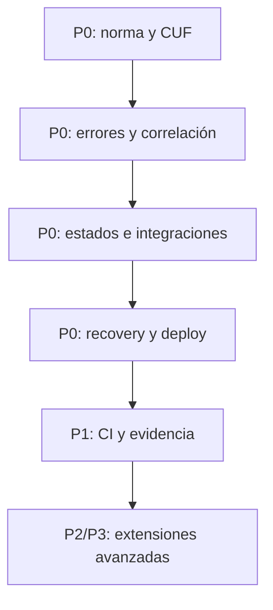

# HACHE BASE — PRODUCTION READINESS ROADMAP

**Estado:** Propuesta de implementación futura; no ejecutada  
**Fecha:** 1 de septiembre de 2026  
**Regla:** cambios incrementales, conservadores, auditables, reversibles y probados.

**Fuente normativa:** `PRODUCTION-READINESS-STANDARD.md` v1.1, especialmente su registro canónico de controles (sección 24). La Checklist no crea trabajo adicional; solo representa esos controles.

---

## 1. Criterios de priorización

- **P0:** evita declarar listo un sistema que puede perder/corromper datos, duplicar efectos, exponer seguridad o no recuperarse.
- **P1:** convierte el baseline en verificable/automatizable y cubre calidad operativa esencial.
- **P2:** aumenta madurez, escala o ergonomía sin bloquear la mayoría de releases.
- **P3:** optimización avanzada o adopción dependiente de casos reales.

Complejidad: **Baja** (docs/tests/config), **Media** (primitive reusable o cambios coordinados), **Alta** (persistencia/infra/proveedores/migración).

## 2. Secuencia recomendada

La secuencia evita construir APM, colas o pipelines pesados antes de que existan contratos claros.

## 3. P0 — Baseline que bloquea Production Ready

| ID | Cambio futuro | Beneficio | Riesgo/Complejidad | Dependencias | Breaking changes posibles |
| --- | --- | --- | --- | --- | --- |
| P0-01 | Incorporar el paquete documental normalizado a `docs/production-readiness/` y enlazar catálogo/README sin duplicar SEO/Design System. Standard permanece como única fuente normativa; Checklist, Audit, Roadmap y Sources son derivados/complementarios. | Fuente única de Definition of Done y trazabilidad por ID. | Baja. Riesgo editorial. | Aprobación de norma. | Ninguno en runtime. |
| P0-02 | Añadir `templates/CRITICAL-USER-FLOWS.md` con nivel A/B/C, estados, pruebas, señales y recovery. | Hace visibles los recorridos que realmente importan. | Baja. | P0-01. | Ninguno. |
| P0-03 | Crear contrato Core de error: códigos internos estables, status HTTP, mensaje seguro y `request_id`; ampliar pruebas 400/401/403/404/409/422/429/500/503. | Respuestas consistentes e investigables. | Media; compatibilidad con payloads actuales. | Inventario de consumidores de `ApiResponse`. | Sí: forma de JSON/status si se reemplaza sin transición. Mantener alias/adaptador. |
| P0-04 | Primitive mínima de request/correlation ID y logging estructurado con redacción de secretos. | Une request, job, webhook y proveedor. | Media; riesgo de PII/log volume. | P0-03 y política de eventos. | Formato de logs, no API si es aditivo. |
| P0-05 | Contrato de estados asíncronos + plantilla de event/operation ledger; integrar primero en fixtures, no en módulos reales. | Evita confundir accepted con confirmed y habilita retry/reconcile. | Media/Alta si incluye schema. | P0-02/P0-04. | Sí: estados/esquema; usar módulo opt-in y migraciones nuevas. |
| P0-06 | Plantilla de inbox/outbox/idempotency claim para Extensions; pruebas de duplicado, concurrencia, evento fuera de orden y reprocess. | Reutiliza lo aprendido en pagos para email/WhatsApp/jobs. | Alta; no todas las apps necesitan cola. | P0-05. | Sí en integraciones adoptantes; nunca activar globalmente. |
| P0-07 | Endurecer headers de forma configurable: CSP report-only helper, HSTS sin `includeSubDomains` por default u opt-in explícito, proxy HTTPS documentado. | Reduce XSS/misconfiguración y evita romper subdominios. | Media; CSP puede romper assets/scripts. | Inventario de recursos por proyecto. | Sí: HSTS/CSP. Desplegar report-only y transición documentada. |
| P0-08 | Completar contrato de sesión: regeneración tras login/elevación, expiración, logout y trusted proxies; tests. | Mitiga fixation y cookies inseguras detrás de proxy. | Media. | Flujo auth real/fixtures. | Posible cierre de sesiones existentes en proyectos al adoptar. |
| P0-09 | Separar liveness/readiness/smoke; health valida cuerpo/version y usa archivo temporal seguro por ejecución. | Evita falsos `HEALTHCHECK_OK`. | Baja/Media. | Error/request ID y endpoint de proyecto. | Variable/contrato de health actual; mantener modo compatible. |
| P0-10 | Registrar fases de deploy y añadir trap de fallo con instrucción/runbook; matriz código/DB/assets/config; ventana de observación. | Fallo parcial visible y recuperable. | Media. | P0-09; staging. | Flujo deploy; ensayar antes de sustituir runner. |
| P0-11 | Plantilla de RPO/RTO y restore drill; prueba de restore aislada y alerta por backup freshness/fallo. | Demuestra recuperación, no solo existencia de dump. | Media/Alta según infra. | Backup actual + staging/storage. | Ninguno si aditivo; coste operativo. |
| P0-12 | Política supply chain: lockfiles, SCA, secret scan, triage/SLA y licencias; implementación por stack. | Evita secretos y dependencias vulnerables en releases. | Media; falsos positivos. | Inventario de stacks. | CI puede bloquear PRs; activar primero en report-only/baseline. |

### Criterio de salida P0

- Normas aprobadas y enlazadas.
- Un fixture A, B y C demuestra clasificación y checklist.
- Error/request ID/log schema pasan tests.
- Health no aprueba cuerpo incorrecto.
- Restore drill y fallo parcial de deploy tienen procedimiento probado.
- Security/supply-chain findings tienen política de bloqueo reproducible.

## 4. P1 — Evidencia y automatización esencial

| ID | Cambio futuro | Beneficio | Riesgo/Complejidad | Dependencias | Breaking changes |
| --- | --- | --- | --- | --- | --- |
| P1-01 | Generar reporte CI de readiness por nivel desde los IDs/metadatos del registro canónico. | Resultado auditable por humano/Codex/CI sin segunda norma. | Media; no fingir evaluación humana ni convertir NOT EVALUATED en PASS. | P0-01/P0-02. | Ninguno. |
| P1-02 | Tests HTTP de headers, cookies, cache, compresión, status, 404/500, redirects y CSP report-only. | Detecta configuración real, no solo PHP. | Media; requiere servidor fixture. | P0-07/P0-09. | CI/fixtures. |
| P1-03 | Lighthouse + accesibilidad automática sobre páginas/CUF fixture con budgets versionados. | Regresión temprana de performance/a11y. | Media; variabilidad de laboratorio. | Servidor/build reproducible. | Puede bloquear por ruido; usar tolerancias/baseline. |
| P1-04 | Plantilla/instrumentación Web Vitals/RUM opt-in con minimización de datos. | Evidencia p75 de campo. | Media; privacidad/volumen. | Política de telemetría. | Extension, no Core runtime. |
| P1-05 | Inventario de terceros, datos compartidos, timeout/fallback y coste performance. | Control de riesgo y bloat. | Baja. | Project Profile. | Ninguno. |
| P1-06 | Matriz de caché por HTML, hashed assets, API pública, privada y errores. | Evita datos privados cacheados y mejora velocidad. | Baja/Media. | Headers/infra fixture. | Cambios de caché requieren invalidación coordinada. |
| P1-07 | Formulario fixture B completo: server validation, CSRF, rate limit, honeypot, estados y dedupe. | Patrón demostrable sin imponer CAPTCHA. | Media. | Error/log/session. | Ninguno si es ejemplo/fixture. |
| P1-08 | Extension de email status/webhooks con accepted/delivered/delayed/bounced/failed y reprocess. | Trazabilidad real de entrega. | Alta; proveedor específico. | P0-05/P0-06. | Schema/integración; opt-in. |
| P1-09 | Inventario de datos/privacidad y plantilla de retención/terceros/cookies. | Minimización y cumplimiento contextual. | Baja; requiere revisión humana/legal. | Nivel/CUF. | Ninguno. |
| P1-10 | Mejorar artifact promotion: construir/testear una vez y desplegar artefacto/commit verificable cuando el stack lo permita. | Reduce drift entre CI y producción. | Alta por infraestructura. | Runner estable. | Sí en pipeline; migrar por proyecto. |
| P1-11 | Política de imágenes/assets/font/third-party budgets automatizable. | Conecta Design System con release real. | Media. | P1-03/P1-05. | CI budgets. |

### Criterio de salida P1

- CI produce un reporte legible y no declara pruebas humanas inexistentes.
- Fixtures A/B/C cubren headers, errores, CUF y budgets.
- Al menos un proyecto B/C piloto produce evidencia de campo, restore y comunicación status.

## 5. P2 — Madurez operativa

| ID | Cambio futuro | Beneficio | Riesgo/Complejidad | Dependencias | Breaking changes |
| --- | --- | --- | --- | --- | --- |
| P2-01 | Extension OpenTelemetry/APM o adaptadores neutrales para logs/metrics/traces. | Correlación distribuida. | Alta; coste y lock-in. | P0-04 schema estable. | Instrumentación/config. |
| P2-02 | Plantillas de alertas sobre golden signals y CUF, con runbooks. | Alertas accionables. | Media; ruido. | Métricas reales. | Ninguno. |
| P2-03 | Chaos/failure fixtures para timeout, 429, 5xx, DNS y storage. | Valida resiliencia. | Media/Alta. | Adapters testeables. | Ninguno en producción. |
| P2-04 | Upload Extension con storage seguro, MIME/content/limits y antivirus opcional. | Capacidad reusable sin inflar Core. | Alta. | Caso real y threat model. | API/storage; opt-in. |
| P2-05 | Rate limit shared-store Extension para anónimo/API/multiinstancia. | Protección consistente al escalar. | Alta. | Redis/DB/edge real. | Config y comportamiento 429. |
| P2-06 | SBOM/provenance y acciones/containers pinneados por digest para nivel C. | Supply-chain trazable. | Media. | P0-12. | Renovación de pipeline. |
| P2-07 | Restore drills programados y evidencia histórica por proyecto C. | Mantiene recuperabilidad en el tiempo. | Media/coste. | P0-11. | Ninguno. |

## 6. P3 — Optimización avanzada y solo con demanda

| ID | Cambio futuro | Beneficio | Riesgo/Complejidad | Dependencias | Breaking changes |
| --- | --- | --- | --- | --- | --- |
| P3-01 | Canary/blue-green automatizado para proyectos C con tráfico/infra que lo justifique. | Reduce blast radius. | Alta y costosa. | Artifact promotion + observabilidad. | Pipeline/infra. |
| P3-02 | SLO/error budgets formales por CUF. | Decisiones de release basadas en fiabilidad. | Media/Alta; necesita tráfico. | Métricas estables. | Proceso, no API. |
| P3-03 | Load/capacity testing periódico y predicción de saturación. | Evita degradación por crecimiento. | Alta. | Perfil de carga real. | Infra de pruebas. |
| P3-04 | WAF/bot management/advanced threat detection. | Protección adicional para exposición alta. | Alta, coste/falsos positivos. | Threat model e incidentes reales. | Tráfico/headers. |
| P3-05 | Multi-region/DR avanzado. | Reduce fallos regionales. | Muy alta. | Requisitos de negocio, RTO/RPO. | Arquitectura/operación. |

P3 no debe entrar al Core por aspiración. Solo se adopta con riesgo, SLO o caso real que pague su complejidad.

## 7. Estrategia de implementación conservadora

Para cada ítem futuro:

1. auditar comportamiento y consumidores actuales;
2. redactar contrato y tests antes de cambiar runtime;
3. crear fixture aislado;
4. mantener compatibilidad o migración explícita;
5. activar de forma opt-in/report-only cuando pueda bloquear tráfico;
6. probar staging, fallo y rollback;
7. revisar PR y CI;
8. pilotear en un proyecto derivado;
9. promover a Core solo después de reutilización demostrada;
10. documentar deuda y detenerse.

## 8. Primer paquete recomendado

La primera misión de implementación permanece limitada, sin ampliación, a **P0-01, P0-02, P0-03, P0-04 y P0-09**: norma/CUF, errores, correlación/logging mínimo y health. Es una superficie acotada, aporta evidencia inmediata y prepara integraciones/recovery sin introducir todavía colas, APM, Redis ni cambios de base generales.
